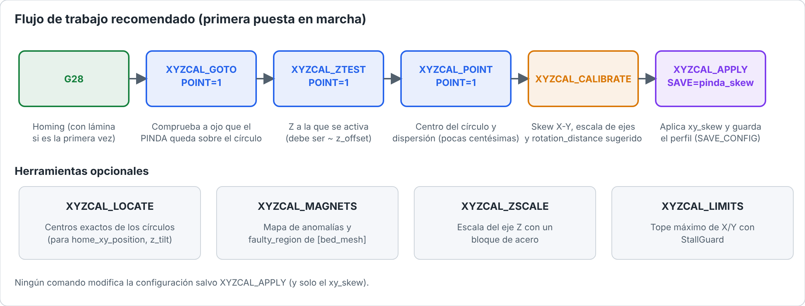

# prusa-xyzcal-klipper

Calibración XYZ al estilo de la **Prusa MK3** para **Klipper**: el sensor PINDA mide los 4 círculos de calibración de la cama calefactora y calcula la perpendicularidad X-Y y la escala de los ejes, igual que hace el firmware original de Prusa. Incluye además herramientas para localizar los círculos con precisión, calcular las `faulty_region` de `[bed_mesh]`, comprobar la escala de Z y medir el tope máximo de X/Y.



> **Importante.** Es un módulo de la comunidad, sin relación con Prusa Research ni con el proyecto Klipper. Mueve el cabezal y baja Z hasta tocar la cama: léete la sección [Seguridad](#seguridad) antes de ejecutar nada.

## Índice

1. [Qué incluye](#qué-incluye)
2. [Estado de las pruebas](#estado-de-las-pruebas)
3. [Requisitos](#requisitos)
4. [Instalación](#instalación)
5. [Mantenerlo actualizado](#mantenerlo-actualizado)
6. [Seguridad](#seguridad)
7. [Configuración](#configuración)
8. [Puesta en marcha paso a paso](#puesta-en-marcha-paso-a-paso)
9. [Referencia de comandos](#referencia-de-comandos)
10. [Cómo funciona y diferencias con Prusa](#cómo-funciona-y-diferencias-con-prusa)
11. [Pruebas offline](#pruebas-offline)
12. [Solución de problemas](#solución-de-problemas)
13. [Licencia y créditos](#licencia-y-créditos)

## Qué incluye

| Comando | Para qué sirve |
|---|---|
| `XYZCAL_GOTO POINT=1..4` | Lleva la boquilla al punto indicado para comprobar a ojo la posición del PINDA. |
| `XYZCAL_ZTEST POINT=1..4` | Baja hasta que el PINDA se activa y dice a qué Z. |
| `XYZCAL_POINT POINT=1..4` | Mide un solo círculo (centro y dispersión). |
| `XYZCAL_CALIBRATE` | Mide los 4 círculos y calcula skew X-Y, escala de X e Y y `rotation_distance` sugerido. |
| `XYZCAL_APPLY [SAVE=nombre]` | Aplica el `xy_skew` medido a `[skew_correction]` y puede guardar el perfil. |
| `XYZCAL_LOCATE` | Mide varias veces el centro exacto de los círculos y da los valores para el `printer.cfg`. |
| `XYZCAL_MAGNETS` | Mapa de la Z de disparo de la cama y propuesta de `faulty_region` para `[bed_mesh]`. |
| `XYZCAL_ZSCALE` | Escala del eje Z usando un bloque de acero de espesor conocido. |
| `XYZCAL_LIMITS` | Tope máximo de X/Y con la detección de bloqueo (StallGuard) del TMC2209. |

Ningún comando cambia la configuración por sí solo, salvo `XYZCAL_APPLY` (y solo el `xy_skew`).

## Estado de las pruebas

Todo el módulo está probado con un simulador y dentro de un Klipper real con MCU simulado. En una impresora real (MK3 con Klipper, SKR 3 EZ, TMC2209, PINDA, sensorless XY) se han ejecutado:

| Comando | En impresora real | En simulación |
|---|---|---|
| `XYZCAL_GOTO`, `XYZCAL_ZTEST`, `XYZCAL_POINT`, `XYZCAL_CALIBRATE`, `XYZCAL_LOCATE` | Sí | Sí |
| `XYZCAL_APPLY` | No | Sí (con el `skew_correction` real de Klipper) |
| `XYZCAL_MAGNETS`, `XYZCAL_ZSCALE`, `XYZCAL_LIMITS` | **No** | Sí (`XYZCAL_LIMITS`: solo el flujo; el MCU simulado no produce bloqueos reales) |

Resultado real de `XYZCAL_CALIBRATE` en esa máquina: desviación de perpendicularidad 0.1305° (`xy_skew` equivalente -0.00228), frente a -0.00243 del perfil CaliLantern de la misma máquina (diferencia de 0.009°). Dispersión de un círculo repetido: ~0.01 mm.

Si algo falla en tu máquina, abre un *issue* con la salida de `XYZCAL_ZTEST` y `XYZCAL_POINT`.

## Requisitos

- Klipper con cinemática cartesiana, `[probe]` configurado con tu PINDA/SuperPINDA y `x_offset` / `y_offset` correctos.
- `[skew_correction]` en `printer.cfg` (solo para `XYZCAL_APPLY`).
- `[bed_mesh]` (solo para `XYZCAL_MAGNETS`).
- Raspberry Pi (o equivalente) con acceso por SSH y `git`.
- Cama MK3 con los 4 círculos de calibración visibles (sin la lámina de acero para la calibración XYZ).

## Instalación


Por SSH, en tu Raspberry Pi:

```bash
cd ~
git clone https://github.com/wencescarlos/prusa-xyzcal-klipper.git
cd prusa-xyzcal-klipper
bash install.sh
```

`install.sh` crea un enlace simbólico `~/klipper/klippy/extras/prusa_xyzcal.py` que apunta al archivo del repositorio y lo añade a `.git/info/exclude` de Klipper para que Moonraker no marque Klipper como «sucio». Si tu Klipper no está en `~/klipper`: `bash install.sh -k /ruta/a/klipper`.

Después:

1. Copia `config/prusa_xyzcal.cfg` a la carpeta de tu configuración (junto a `printer.cfg`) y añade en `printer.cfg`:
   ```ini
   [include prusa_xyzcal.cfg]
   ```
   Ajusta `first_point_x` / `first_point_y` según [Configuración](#configuración).
2. Reinicia Klipper con `FIRMWARE_RESTART` (o `sudo systemctl restart klipper`).
3. Comprueba que carga: en la consola escribe `XYZCAL_GOTO` sin parámetros; debe responder pidiendo `POINT` y no «Unknown command».

Instalación manual (sin `git`): copia `prusa_xyzcal.py` a `~/klipper/klippy/extras/` y reinicia Klipper. No recibirás actualizaciones automáticas.

Desinstalar: `bash install.sh -u`, quitar la sección `[prusa_xyzcal]` del `printer.cfg` y reiniciar Klipper.

## Mantenerlo actualizado

### Automático desde Mainsail / Fluidd (recomendado)

Añade a `moonraker.conf` (hay una copia en `config/moonraker_update_manager.conf`):

```ini
[update_manager prusa_xyzcal]
type: git_repo
path: ~/prusa-xyzcal-klipper
origin: https://github.com/wencescarlos/prusa-xyzcal-klipper.git
primary_branch: main
install_script: install.sh
is_system_service: False
managed_services: klipper
```

Reinicia Moonraker (`sudo systemctl restart moonraker`). En la interfaz web, pestaña **Máquina → Actualizaciones**, aparecerá `prusa_xyzcal` y se actualizará con el botón de siempre: Moonraker hace `git pull`, ejecuta `install.sh` y reinicia Klipper.

### A mano

```bash
cd ~/prusa-xyzcal-klipper
git pull
sudo systemctl restart klipper     # o FIRMWARE_RESTART desde la consola
```

### Tras actualizar Klipper

Actualizar Klipper no toca el enlace (es un archivo sin seguimiento). Si algún día Klipper cambia su API interna y el módulo deja de cargar, revisa los *issues* o actualiza este repositorio. Si el enlace desapareciera, vuelve a ejecutar `bash install.sh`.

## Seguridad

- **Calibración XYZ: quita la lámina de acero.** Prusa hace esta fase sin lámina: los círculos están en la cama calefactora. Con la cama fría.
- Tu Z=0 se calibró con la lámina puesta; sin ella, la cama queda unas décimas más abajo. `z_floor` es el límite de seguridad: la boquilla no bajará de esa Z. Si el PINDA no se activara, la boquilla quedaría en `z_floor`.
- **Klipper no limita el descenso del homing de Z.** Con `position_max: 210` puede bajar hasta unos 313 mm; si el PINDA no dispara, la boquilla baja hasta chocar. Por eso la primera vez que homees sobre un círculo: primero `G28 X Y`, luego `G1 X12 Y18 F3000` y comprueba a ojo que el PINDA queda sobre el círculo; haz el primer `G28` completo **con la lámina puesta** y la mano en el paro de emergencia (`M112`).
- Ten a mano el paro de emergencia las primeras veces y no dejes la impresora sola.
- `XYZCAL_LIMITS` provoca un choque mecánico en el tope máximo (como el homing en el mínimo, pero en el lado opuesto). Empieza con `OVERRUN=5`.

## Configuración


Los valores de `first_point_x` / `first_point_y` son la posición de la **boquilla** (coordenadas de Klipper) cuando el PINDA está sobre el círculo frontal izquierdo. Con `x_offset: 23` e `y_offset: 5` en `[probe]`, el PINDA queda en X=35, Y=23.

```ini
[prusa_xyzcal]
first_point_x: 12.0
first_point_y: 18.0
dot_spacing_x: 208.0    # separación real de los círculos en la MK3
dot_spacing_y: 192.0
z_start: 3.0
z_floor: 1.0
```

### G28 sobre el primer círculo (seguro incluso sin lámina)

Sin lámina el PINDA solo dispara sobre los círculos; en el centro de la cama no dispara. Para poder homear sin lámina, haz el homing de Z sobre el primer círculo. En Klipper `home_xy_position` también es una posición de la **boquilla**, no del sensor:

```ini
[safe_z_home]
home_xy_position: 12,18
z_hop: 15
```

`[z_tilt]` también puede medir sobre los dos primeros círculos (los puntos de `z_tilt` son posiciones de la boquilla):

```ini
[z_tilt]
points:
    12,18
    220,18
```

Con lámina, homear en el círculo en vez del centro puede mover el cero unas décimas: revisa la primera capa o repite `PROBE_CALIBRATE`. Hay ejemplos en `config/macros_ejemplo.cfg`.

## Puesta en marcha paso a paso

1. `G28`
2. `XYZCAL_GOTO POINT=1` (y luego 2, 3 y 4). Comprueba a ojo que el **PINDA** (no la boquilla) queda sobre el círculo. Un error de pocos mm lo corrige la búsqueda gruesa; más de ~4 mm hay que ajustar `first_point_x/y`.
3. `XYZCAL_ZTEST POINT=1` baja hasta el primer contacto y dice a qué Z se activa. Con `G28` sobre el círculo debe dar una Z cercana a tu `z_offset`. Si no se activa, repite con `Z_FLOOR=1.0`, `0.5`, `0.0`, `-0.4`, vigilando. Tu `z_floor` definitivo debe quedar unas décimas por debajo de la Z de activación.
4. `XYZCAL_POINT POINT=1` mide un círculo completo. Debe dar una dispersión de pocas centésimas de mm; repítelo y comprueba que el resultado se repite.
5. `XYZCAL_CALIBRATE` mide los 4 círculos (unos minutos) e imprime el informe sin cambiar nada. Usa `COARSE=0` si la posición nominal ya es buena.
6. Si el informe es razonable: `XYZCAL_APPLY SAVE=pinda_skew` y después `SAVE_CONFIG`.

## Referencia de comandos

### XYZCAL_CALIBRATE: cómo leer el informe


- **Desviación de perpendicularidad:** lo que corrige. Umbrales de Prusa: < 0.12° perfecto, hasta 0.25° leve, más es extremo.
- **Error tras ajuste:** debería ser < 0.1 mm. Prusa da por fallido > 0.8 mm.
- **xy_skew equivalente:** el valor para `[skew_correction]`. Compáralo con el de un perfil medido sobre una pieza impresa (p. ej. CaliLantern): deben ser parecidos. Si difieren mucho, fíate más de la pieza impresa, que mide la geometría real de lo que imprimes.
- **Separación X/Y medida** frente al nominal (208 / 192 mm): ver la escala más abajo.

#### Escala de los ejes y `rotation_distance`

`XYZCAL_CALIBRATE` calcula la escala de X e Y (separación medida entre círculos dividida por la nominal) y, con ella, el `rotation_distance` sugerido leyendo el valor actual de `[stepper_x]` y `[stepper_y]`:

```
escala = medido / nominal
rotation_distance_nuevo = rotation_distance_actual / escala
```

Escala < 1 significa que la máquina se mueve **más** de lo que se le manda (las piezas salen grandes) y el `rotation_distance` **sube**.

**No cambies nada solo con esto.** El cálculo supone que los círculos de tu cama están exactamente a 208 × 192 mm. Comprueba con un cuadrado de 100 mm impreso y medido con calibre: `nuevo = actual × (medido / 100)`. Si coincide con el sugerido, cámbialo en `[stepper_x]` y `[stepper_y]`, reinicia y repite la comprobación. El módulo nunca modifica el `rotation_distance`.

### XYZCAL_APPLY y perfiles de skew

`XYZCAL_APPLY` aplica el `xy_skew` medido. Para conservar `xz` / `yz` de otro perfil y sustituir solo `xy`:

```gcode
SKEW_PROFILE LOAD=mi_perfil_skew
XYZCAL_CALIBRATE
XYZCAL_APPLY SAVE=pinda_skew
SAVE_CONFIG
```

Y en tu `PRINT_START`: `SKEW_PROFILE LOAD=pinda_skew`. Solo se actualiza `xy_skew`; el giro de los ejes respecto a la cama no se corrige (no afecta a las dimensiones). El escaneo ignora el skew activo (mueve el cabezal en bruto).

### XYZCAL_LOCATE: localizar con precisión los círculos

```
XYZCAL_LOCATE [POINTS=1,2,3,4] [REPEAT=2] [REHOME=1] [COARSE=1]
```

Mide el centro de cada círculo `REPEAT` veces y da, en coordenadas de **boquilla**, el centro medio, el desvío frente al nominal, la dispersión entre rondas, el radio y la Z de disparo. Al final imprime un bloque para pegar: `home_xy_position`, `points` de `[z_tilt]` y `point1..point4` de `[prusa_xyzcal]`.

- Con `REPEAT>1` y `REHOME=1` (por defecto) hace `G28 X Y` entre rondas: la dispersión incluye la repetibilidad del homing sensorless. Si pasa de 0.1 mm, avisa.
- **Haz la medida con la máquina ya caliente** (justo después de otro `G28`): en pruebas reales, el primer homing en frío quedó unos 0.13-0.2 mm desplazado en X respecto a los siguientes (que coincidieron a unas milésimas).
- `point1..point4` sustituyen a las posiciones calculadas con `first_point_*` y `dot_spacing_*`. **Deja `dot_spacing_x/y` en 208 / 192**: si pones los valores medidos pierdes la información de escala.
- El círculo tiene ~3.2 mm de radio y la Z de disparo varía solo centésimas dentro de ±2 mm: para `G28` y `z_tilt` la precisión submilimétrica no es crítica.

### XYZCAL_MAGNETS: `faulty_region` de `[bed_mesh]`


```
XYZCAL_MAGNETS [STEP=8] [THRESHOLD=] [MARGIN=2] [MIN_CELLS=2]
               [X_MIN= Y_MIN= X_MAX= Y_MAX=] [CSV=/ruta/datos.csv]
```

Mide la Z de disparo del PINDA en una malla que cubre el área de tu `[bed_mesh]` (`mesh_min` / `mesh_max`, en coordenadas de sonda, las mismas que usa `faulty_region`). Ajusta una superficie suave (el alabeo de la cama) y marca los puntos que se salen de ella más que un umbral: los imanes producen saltos bruscos y locales. Agrupa los puntos marcados, los envuelve en rectángulos y los fusiona si se solapan (`bed_mesh` no admite regiones solapadas).

La salida incluye un mapa en texto (`.` normal, `+` Z más alta, `-` más baja, `?` sin disparo), el umbral usado y el bloque `faulty_region_N_min/max` para pegar.

- `STEP`: paso de la malla en mm. 8 mm tarda del orden de 15-20 min (~2 s por punto; lo estima al empezar). Baja a 5 para afinar los bordes.
- `THRESHOLD`: automático por defecto (4 sigma del alabeo, mínimo 0.04 mm). Si marca demasiado, súbelo; si no ve imanes, bájalo (mín. práctico ~0.03).
- `MARGIN`: holgura extra por lado, además de medio paso de malla.
- **Hazlo con la lámina puesta** y la cama fría, tras un `G28`: los `faulty_region` sirven para el mallado que haces al imprimir, y el PINDA mide a través de la lámina.
- No modifica nada: copia el bloque y quita las `faulty_region` antiguas antes de pegarlo.

### XYZCAL_ZSCALE: escala del eje Z

```
XYZCAL_ZSCALE THICKNESS=20 BLOCK_X=100 BLOCK_Y=105 [REF_DIST=40]
              [REF_X1= REF_Y1= REF_X2= REF_Y2= SINGLE=1]
              [REF_THICKNESS=0] [REPEAT=3] [Z_START=]
```

Necesita un **bloque de acero** (galga, regla o pletina rectificada) de espesor T conocido con precisión. La Z de disparo sobre el bloque debe ser T mm mayor que sobre la cama; si la Z mandada entre ambas es distinta de T, el eje Z no tiene la escala correcta.

- Coloca el bloque (mín. ~15 × 15 mm, plano) con el PINDA centrado encima. `BLOCK_X/Y` son coordenadas de **sonda**.
- Mide dos referencias a ±40 mm del bloque (cancela el desnivel de la cama) alternando con el bloque, `REPEAT` veces (cancela la deriva térmica).
- Resultado: factor `k = real / mandado` y el `rotation_distance` sugerido de `[stepper_z]`: `nuevo = actual × k`. Con dos motores Z cambia los dos por igual.
- Precisión ~0.1 % con un bloque de 20 mm; un error de espesor de 0.02 mm ya son 0.1 %.
- **Material:** sobre un bloque grueso el PINDA dispara a otra altura que sobre la lámina, y eso falsea la diferencia. Lo ideal es usar también bloques de acero como referencia (`REF_THICKNESS=10` con un bloque de 20).
- Alternativa sin bloques: imprime una torre de 50-100 mm y mídela con calibre: `nuevo = actual × (medido / teórico)`.

### XYZCAL_LIMITS: tope máximo de X/Y

```
XYZCAL_LIMITS [AXES=XY] [REPEAT=2] [SPEED=] [OVERRUN=15] [MARGIN=1]
```

Lleva cada eje (con el otro en el centro y Z a 8 mm o más) hacia su tope **máximo** con el mismo `virtual_endstop` del TMC2209 que usas para el cero y registra dónde se detecta el bloqueo. Informa del tope medido, su diferencia con `position_max` y un `position_max` sugerido (tope menos `MARGIN`); avisa si el tope físico queda antes que tu `position_max`.

- `SPEED` por defecto es el `homing_speed` del eje: `driver_SGTHRS` está ajustado a esa velocidad y a otra la detección puede fallar.
- `OVERRUN` es lo que avanza más allá de `position_max` buscando el tope.
- Al terminar hace `G28` de los ejes medidos; no cambia la configuración.
- Sirve para comprobar límites, no para calibrar la escala: no conoces la distancia real hasta el tope.

### Parámetros opcionales de `[prusa_xyzcal]`

`iterations` (3), `scan_lower` (0.1), `edge_span` (16), `coarse_step` (2), `travel_speed`, `scan_speed`, `z_speed`, `sensor_reads` (1; sube a 3 si hay ruido), `settle_time` (0.02), `point1..point4`. Los comandos aceptan `Z_START` y `Z_FLOOR`.

### Varios golpes de homing

Con homing sensorless **no** cambies `homing_retract_dist` de 0: el pin DIAG del TMC2209 sigue activo tras el golpe y Klipper da «Endstop stepper_x still triggered after retract». Para golpear dos veces, repite `G28` en una macro y llámala en `PRINT_START`:

```ini
[gcode_macro HOME_DOBLE]
gcode:
  G28 X Y
  G28 X Y
  G28 Z
```

## Cómo funciona y diferencias con Prusa


Igual que Prusa (`mesh_bed_calibration.cpp`): los 4 puntos de la cama V2, la búsqueda del punto (primer contacto, bajar 0.1 mm, bordes en X e Y, repetir centrando), el ajuste de mínimos cuadrados con escala unidad y los umbrales de aviso.

Distinto: Prusa detiene el movimiento por hardware cuando el PINDA cambia de estado. Aquí se mueve a pasos pequeños y se consulta el sensor (como `QUERY_PROBE`), afinando por bisección. Es más lento (unos minutos), pero no toca el endstop del sondeo ni usa APIs internas, salvo `XYZCAL_LIMITS`, que usa `HomingMove`. Como el PINDA tiene histéresis, todas las lecturas se toman siempre bajando (o saliendo del centro hacia fuera), de modo que el efecto se cancela al promediar bordes opuestos.

El módulo mide la perpendicularidad X-Y y la escala; no corrige el giro de los ejes respecto a la cama. Los imanes de la cama no se miden en la calibración XYZ: usa `XYZCAL_MAGNETS` y `faulty_region` en `[bed_mesh]`.

## Pruebas offline

Sin impresora, desde la raíz del repositorio:

```bash
python3 tests/test_simulacion.py
# opcional: con el skew_correction real de Klipper
python3 tests/test_simulacion.py ~/klipper/klippy/extras/skew_correction.py
```

Simula una cama MK3 con un PINDA con histéresis y ruido, ejes torcidos, escala, imanes y bloque de acero. Debe terminar con `RESULTADO: TODO CORRECTO`.

## Solución de problemas

| Síntoma | Causa y solución |
|---|---|
| `Unknown command: XYZCAL_...` | El módulo no cargó. Comprueba el enlace en `~/klipper/klippy/extras/prusa_xyzcal.py`, que `[prusa_xyzcal]` está en la configuración y reinicia con `FIRMWARE_RESTART`. |
| `Haz G28 antes de calibrar` | Todos los comandos exigen X, Y y Z homeados. |
| `No se detecta el punto cerca de (...)` | El PINDA no se activó. ¿Quitaste la lámina? Revisa `z_floor` y la posición con `XYZCAL_GOTO`. |
| `No se encuentra el borde X del punto` | El sensor sigue activo a 16 mm del centro. El módulo ya reintenta subiendo la altura de barrido; si persiste, usa `COARSE=1` o revisa la posición. |
| `El sensor ya está activado a Z=3.00` | Hay metal debajo o la cama está caliente. Usa la cama fría y revisa `z_start`. |
| `XYZCAL_ZTEST` da una Z distinta de tu `z_offset` | Debería coincidir con el disparo del homing (±0.01-0.02). Si difiere unas décimas, revisa que el homing esté sobre el círculo. |
| `Endstop stepper_x still triggered after retract` | `homing_retract_dist` distinto de 0 con sensorless. Déjalo en 0 y usa una macro con dos `G28`. |
| La dispersión de `XYZCAL_LOCATE` es grande en la ronda 1 | El primer homing en frío no coincide con los siguientes. Repite con la máquina caliente. |

## Licencia y créditos

GNU GPLv3 (ver `LICENSE`), la misma que Klipper y el firmware de Prusa del que se toma el algoritmo.

- Algoritmo de calibración tomado de [Prusa-Firmware](https://github.com/prusa3d/Prusa-Firmware) (`mesh_bed_calibration.cpp`).
- Se integra con [Klipper](https://github.com/Klipper3d/klipper) mediante un módulo `extras` y su API pública.
- No está afiliado ni respaldado por Prusa Research ni por el proyecto Klipper.
