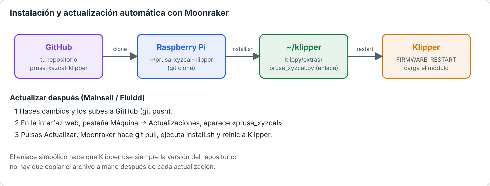
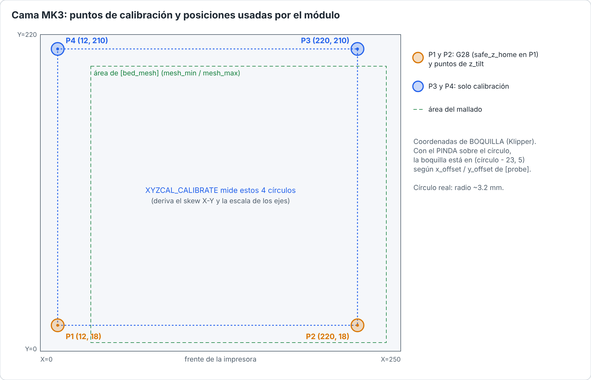
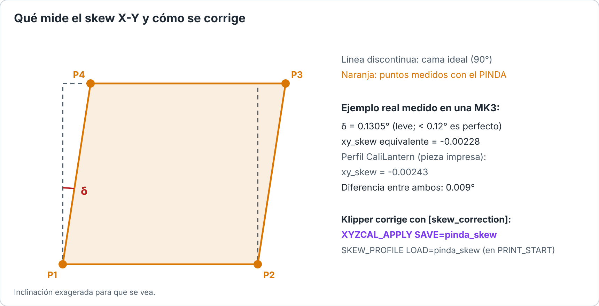
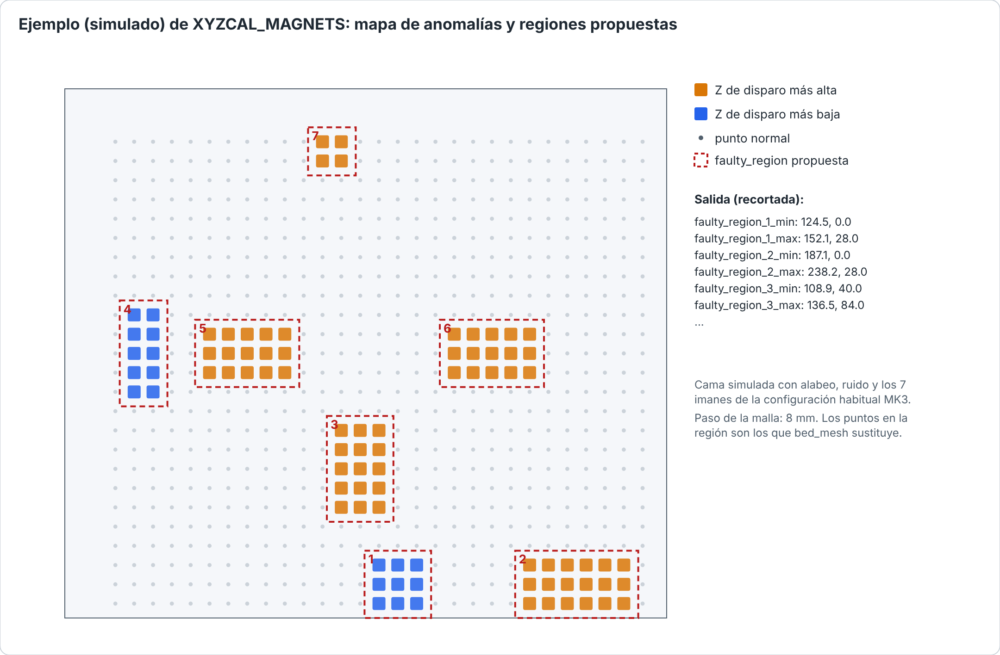
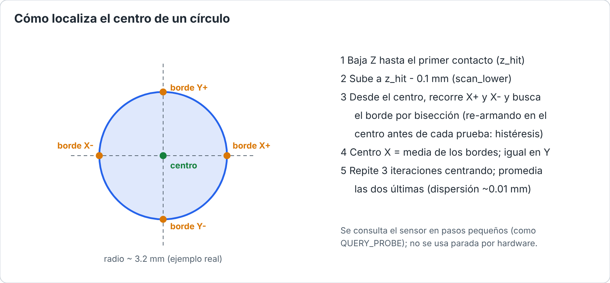

# prusa-xyzcal-klipper

Calibración XYZ al estilo de la **Prusa MK3** para **Klipper**: el sensor PINDA mide los 4 círculos de calibración de la cama calefactora y calcula la perpendicularidad X-Y y la escala de los ejes, igual que hace el firmware original de Prusa. Incluye además herramientas para localizar los círculos con precisión, calcular las `faulty_region` de `[bed_mesh]`, comprobar la escala de Z y medir el tope máximo de X/Y.


> **Importante.** Es un módulo de la comunidad, sin relación con Prusa Research ni con el proyecto Klipper. Mueve el cabezal y baja Z hasta tocar la cama: léete la sección [Seguridad](#seguridad) antes de ejecutar nada.

> [!WARNING]
> **Uso bajo tu propia responsabilidad.** Este software se ofrece "tal cual", sin ninguna garantía. Solo se ha probado en una impresora concreta (ver [Estado de las pruebas](#estado-de-las-pruebas)); en otras máquinas, configuraciones o versiones de Klipper puede comportarse de forma distinta. Si lo instalas y lo usas en tu impresora, lo haces bajo tu exclusiva responsabilidad: el autor no se hace responsable de daños en la impresora, la cama, la boquilla, el sensor u otros componentes, ni de cualquier otro perjuicio derivado de su uso. Ver [Aviso de responsabilidad](#aviso-de-responsabilidad).

## Índice

1. [Qué incluye](#qué-incluye)
2. [Estado de las pruebas](#estado-de-las-pruebas)
3. [Requisitos](#requisitos)
4. [Instalación](#instalación)
5. [Mantenerlo actualizado](#mantenerlo-actualizado)
6. [Seguridad](#seguridad)
7. [Configuración](#configuración)
8. [Ajuste básico paso a paso](#ajuste-básico-paso-a-paso)
9. [Ejemplos de uso](#ejemplos-de-uso)
10. [Referencia de comandos](#referencia-de-comandos)
11. [Cómo funciona y diferencias con Prusa](#cómo-funciona-y-diferencias-con-prusa)
12. [Pruebas offline](#pruebas-offline)
13. [Solución de problemas](#solución-de-problemas)
14. [Aviso de responsabilidad](#aviso-de-responsabilidad)
15. [Licencia y créditos](#licencia-y-créditos)

## Qué incluye

| Comando | Para qué sirve |
|---|---|
| `XYZCAL_GOTO POINT=1..4` | Lleva la boquilla al punto indicado para comprobar a ojo la posición del PINDA. |
| `XYZCAL_ZTEST POINT=1..4` | Baja hasta que el PINDA se activa y dice a qué Z. |
| `XYZCAL_POINT POINT=1..4` | Mide un solo círculo (centro y dispersión). |
| `XYZCAL_CALIBRATE` | Mide los 4 círculos y calcula skew X-Y, escala de X e Y y `rotation_distance` sugerido. |
| `XYZCAL_APPLY [SAVE=nombre]` | Aplica el `xy_skew` medido a `[skew_correction]` y puede guardar el perfil. |
| `XYZCAL_LOCATE` | Mide varias veces el centro exacto de los círculos y da los valores para el `printer.cfg`. |
| `XYZCAL_MAGNETS` | Mapa de la Z de disparo de la cama y propuesta de `faulty_region` para `[bed_mesh]`. |
| `XYZCAL_ZSCALE` | Escala del eje Z usando un bloque de acero de espesor conocido. |
| `XYZCAL_LIMITS` | Tope máximo de X/Y con la detección de bloqueo (StallGuard) del TMC2209. |

Ningún comando cambia la configuración por sí solo, salvo `XYZCAL_APPLY` (y solo el `xy_skew`).

## Estado de las pruebas

Todo el módulo está probado con un simulador y dentro de un Klipper real con MCU simulado. En una impresora real (MK3 con Klipper, SKR 3 EZ, TMC2209, PINDA, sensorless XY) se han ejecutado:

| Comando | En impresora real | En simulación |
|---|---|---|
| `XYZCAL_GOTO`, `XYZCAL_ZTEST`, `XYZCAL_POINT`, `XYZCAL_CALIBRATE`, `XYZCAL_LOCATE` | Sí | Sí |
| `XYZCAL_APPLY` | No | Sí (con el `skew_correction` real de Klipper) |
| `XYZCAL_MAGNETS`, `XYZCAL_ZSCALE`, `XYZCAL_LIMITS` | **No** | Sí (`XYZCAL_LIMITS`: solo el flujo; el MCU simulado no produce bloqueos reales) |

Resultado real de `XYZCAL_CALIBRATE` en esa máquina: desviación de perpendicularidad 0.1305° (`xy_skew` equivalente -0.00228), frente a -0.00243 del perfil CaliLantern de la misma máquina (diferencia de 0.009°). Dispersión de un círculo repetido: ~0.01 mm.

Si algo falla en tu máquina, abre un *issue* con la salida de `XYZCAL_ZTEST` y `XYZCAL_POINT`.

## Requisitos

- Klipper con cinemática cartesiana, `[probe]` configurado con tu PINDA/SuperPINDA y `x_offset` / `y_offset` correctos.
- `[skew_correction]` en `printer.cfg` (solo para `XYZCAL_APPLY`).
- `[bed_mesh]` (solo para `XYZCAL_MAGNETS`).
- Raspberry Pi (o equivalente) con acceso por SSH y `git`.
- Cama MK3 con los 4 círculos de calibración visibles (sin la lámina de acero para la calibración XYZ).

## Instalación

> Al instalar este repositorio en tu impresora aceptas el [Aviso de responsabilidad](#aviso-de-responsabilidad): lo usas bajo tu propia responsabilidad.



Por SSH, en tu Raspberry Pi:

```bash
cd ~
git clone https://github.com/wencescarlos/prusa-xyzcal-klipper.git
cd prusa-xyzcal-klipper
bash install.sh
```

`install.sh` crea un enlace simbólico `~/klipper/klippy/extras/prusa_xyzcal.py` que apunta al archivo del repositorio y lo añade a `.git/info/exclude` de Klipper para que Moonraker no marque Klipper como «sucio». Si tu Klipper no está en `~/klipper`: `bash install.sh -k /ruta/a/klipper`.

Después:

1. Copia `config/prusa_xyzcal.cfg` a la carpeta de tu configuración (junto a `printer.cfg`) y añade en `printer.cfg`:
   ```ini
   [include prusa_xyzcal.cfg]
   ```
   Ajusta `first_point_x` / `first_point_y` según [Configuración](#configuración).
2. Reinicia Klipper con `FIRMWARE_RESTART` (o `sudo systemctl restart klipper`).
3. Comprueba que carga: en la consola escribe `XYZCAL_GOTO` sin parámetros; debe responder pidiendo `POINT` y no «Unknown command».

Instalación manual (sin `git`): copia `prusa_xyzcal.py` a `~/klipper/klippy/extras/` y reinicia Klipper. No recibirás actualizaciones automáticas.

Desinstalar: `bash install.sh -u`, quitar la sección `[prusa_xyzcal]` del `printer.cfg` y reiniciar Klipper.

## Mantenerlo actualizado

### Automático desde Mainsail / Fluidd (recomendado)

Añade a `moonraker.conf` (hay una copia en `config/moonraker_update_manager.conf`):

```ini
[update_manager prusa_xyzcal]
type: git_repo
path: ~/prusa-xyzcal-klipper
origin: https://github.com/wencescarlos/prusa-xyzcal-klipper.git
primary_branch: main
install_script: install.sh
is_system_service: False
managed_services: klipper
```

Reinicia Moonraker (`sudo systemctl restart moonraker`). En la interfaz web, pestaña **Máquina → Actualizaciones**, aparecerá `prusa_xyzcal` y se actualizará con el botón de siempre: Moonraker hace `git pull`, ejecuta `install.sh` y reinicia Klipper.

### A mano

```bash
cd ~/prusa-xyzcal-klipper
git pull
sudo systemctl restart klipper     # o FIRMWARE_RESTART desde la consola
```

### Tras actualizar Klipper

Actualizar Klipper no toca el enlace (es un archivo sin seguimiento). Si algún día Klipper cambia su API interna y el módulo deja de cargar, revisa los *issues* o actualiza este repositorio. Si el enlace desapareciera, vuelve a ejecutar `bash install.sh`.

## Seguridad

- **Calibración XYZ: quita la lámina de acero.** Prusa hace esta fase sin lámina: los círculos están en la cama calefactora. Con la cama fría.
- Tu Z=0 se calibró con la lámina puesta; sin ella, la cama queda unas décimas más abajo. `z_floor` es el límite de seguridad: la boquilla no bajará de esa Z. Si el PINDA no se activara, la boquilla quedaría en `z_floor`.
- **Klipper no limita el descenso del homing de Z.** Con `position_max: 210` puede bajar hasta unos 313 mm; si el PINDA no dispara, la boquilla baja hasta chocar. Por eso la primera vez que homees sobre un círculo: primero `G28 X Y`, luego `G1 X12 Y18 F3000` y comprueba a ojo que el PINDA queda sobre el círculo; haz el primer `G28` completo **con la lámina puesta** y la mano en el paro de emergencia (`M112`).
- Ten a mano el paro de emergencia las primeras veces y no dejes la impresora sola.
- `XYZCAL_LIMITS` provoca un choque mecánico en el tope máximo (como el homing en el mínimo, pero en el lado opuesto). Empieza con `OVERRUN=5`.

## Configuración



Los valores de `first_point_x` / `first_point_y` son la posición de la **boquilla** (coordenadas de Klipper) cuando el PINDA está sobre el círculo frontal izquierdo. Con `x_offset: 23` e `y_offset: 5` en `[probe]`, el PINDA queda en X=35, Y=23.

```ini
[prusa_xyzcal]
first_point_x: 12.0
first_point_y: 18.0
dot_spacing_x: 208.0    # separación real de los círculos en la MK3
dot_spacing_y: 192.0
z_start: 3.0
z_floor: 1.0
```

### G28 sobre el primer círculo (seguro incluso sin lámina)

Sin lámina el PINDA solo dispara sobre los círculos; en el centro de la cama no dispara. Para poder homear sin lámina, haz el homing de Z sobre el primer círculo. En Klipper `home_xy_position` también es una posición de la **boquilla**, no del sensor:

```ini
[safe_z_home]
home_xy_position: 12,18
z_hop: 15
```

`[z_tilt]` también puede medir sobre los dos primeros círculos (los puntos de `z_tilt` son posiciones de la boquilla):

```ini
[z_tilt]
points:
    12,18
    220,18
```

Con lámina, homear en el círculo en vez del centro puede mover el cero unas décimas: revisa la primera capa o repite `PROBE_CALIBRATE`. Hay ejemplos en `config/macros_ejemplo.cfg`.

## Ajuste básico paso a paso

Guía para usar **todas** las opciones del programa, en el orden recomendado. Las partes 1 y 2 se hacen **con la lámina puesta**, la 3 **sin lámina** y la 4 vuelve a ponerla. Tiempos orientativos (los de `CALIBRATE` y `LOCATE` son de una MK3 real; los demás son estimaciones): `CALIBRATE` ~8 min, `LOCATE REPEAT=3` ~18 min, `MAGNETS` ~15-20 min.

### Parte 1: comprobar que el módulo carga (lámina puesta)

1. Reinicia Klipper y escribe en la consola:
   ```gcode
   XYZCAL_GOTO
   ```
   Debe responder `missing POINT`. Si dice `Unknown command`, el módulo no cargó (ver [Solución de problemas](#solución-de-problemas)).
2. Con la mano en el paro de emergencia, haz el primer homing completo. Con la lámina puesta el PINDA dispara en cualquier sitio, así que solo compruebas el movimiento:
   ```gcode
   G28
   GET_POSITION
   ```
   Tras el `G28`, Z debe valer el `z_hop` de `[safe_z_home]` (15 si usas el ejemplo).

### Parte 2: mapa de imanes y límites (lámina puesta, cama fría)

3. **Límites de X/Y** (opcional; es un choque mecánico en el tope máximo, empieza corto):
   ```gcode
   G28
   XYZCAL_LIMITS AXES=X OVERRUN=5
   XYZCAL_LIMITS AXES=Y OVERRUN=5
   ```
   Si los resultados cuadran, repite los dos ejes de una vez con `XYZCAL_LIMITS AXES=XY REPEAT=3`. Si el tope físico queda antes que tu `position_max`, baja el `position_max` al valor sugerido.
4. **`faulty_region` de `[bed_mesh]`:**
   ```gcode
   G28
   XYZCAL_MAGNETS STEP=8 CSV=/home/pi/printer_data/config/imanes.csv
   ```
   Copia el bloque `faulty_region_N_min/max` de la salida a `[bed_mesh]` (borrando antes las regiones antiguas), haz `FIRMWARE_RESTART` y comprueba:
   ```gcode
   G28
   BED_MESH_CALIBRATE
   BED_MESH_OUTPUT PGP=1
   ```
   En la salida deben aparecer los puntos «faulty region». Si el mapa marcó demasiado o no vio nada, repite con `THRESHOLD=` (ver [XYZCAL_MAGNETS](#xyzcal_magnets-faulty_region-de-bed_mesh)).
5. **Escala del eje Z** (opcional; necesitas un bloque de acero de espesor conocido). Coloca el bloque con el PINDA centrado encima:
   ```gcode
   G28
   XYZCAL_ZSCALE THICKNESS=20 BLOCK_X=100 BLOCK_Y=105
   ```
   Lee el factor `k` y la incertidumbre. Si la desviación está dentro del error de medida, no cambies nada.

### Parte 3: calibración XYZ (SIN lámina, cama fría)

6. **Quita la lámina** y comprueba a ojo (con la mano en el paro de emergencia en el `G28`) que el PINDA (no la boquilla) queda sobre cada círculo:
   ```gcode
   G28
   XYZCAL_GOTO POINT=1
   XYZCAL_GOTO POINT=2
   XYZCAL_GOTO POINT=3
   XYZCAL_GOTO POINT=4
   ```
   Si no está sobre el círculo, ajusta `first_point_x/y` en `[prusa_xyzcal]` y reinicia. Un error de pocos mm lo corrige la búsqueda gruesa; más de ~4 mm hay que ajustarlo.
7. **Altura de activación.** Baja `Z_FLOOR` poco a poco, vigilando, hasta que el PINDA se active:
   ```gcode
   XYZCAL_ZTEST POINT=1 Z_FLOOR=1.5
   XYZCAL_ZTEST POINT=1 Z_FLOOR=1.0
   XYZCAL_ZTEST POINT=1 Z_FLOOR=0.5
   ```
   Con `G28` sobre el círculo debe dar una Z cercana a tu `z_offset`. Pon en `[prusa_xyzcal]` un `z_floor` unas décimas por debajo de esa Z.
8. **Medir un círculo** (dispersión de pocas centésimas de mm; repítelo para ver que se repite):
   ```gcode
   XYZCAL_POINT POINT=1
   XYZCAL_POINT POINT=1
   ```
9. **Centros exactos** (opcional, recomendado). Con la máquina ya caliente, haz el homing doble justo antes:
   ```gcode
   G28
   G28
   XYZCAL_LOCATE REPEAT=3
   ```
   Pega en `printer.cfg` el bloque que imprime (`home_xy_position`, `points` de `[z_tilt]` y `point1..point4`), deja `dot_spacing_x/y` en 208 / 192 y haz `FIRMWARE_RESTART`. A partir de ahí puedes usar `COARSE=0`.
10. **Calibración de los 4 círculos** (informe sin cambiar nada):
    ```gcode
    G28
    XYZCAL_CALIBRATE COARSE=0
    ```
    Si no has hecho el paso 9, usa `XYZCAL_CALIBRATE` sin parámetros. Cómo leer el informe: [XYZCAL_CALIBRATE](#xyzcal_calibrate-cómo-leer-el-informe).
11. **Aplicar el skew** (solo si el informe es razonable y no has reiniciado Klipper desde el paso 10):
    ```gcode
    XYZCAL_APPLY SAVE=pinda_skew
    SAVE_CONFIG
    ```
    Tras el reinicio que hace `SAVE_CONFIG`, comprueba el perfil:
    ```gcode
    SKEW_PROFILE LOAD=pinda_skew
    GET_CURRENT_SKEW
    ```
    Y añade `SKEW_PROFILE LOAD=pinda_skew` a tu `PRINT_START`.

### Parte 4: volver a poner la lámina

12. **Pon la lámina** y haz `G28`. Con lámina, homear en el círculo en vez del centro puede mover el cero unas décimas: revisa la primera capa o repite `PROBE_CALIBRATE` y `SAVE_CONFIG`.
13. **Homing doble** (opcional): crea la macro `HOME_DOBLE` de [Varios golpes de homing](#varios-golpes-de-homing) y llámala al principio de `PRINT_START` en lugar de `G28`.
14. **Escala de X e Y** (opcional): imprime un cuadrado de 100 mm, mídelo con calibre y calcula `nuevo = actual × (medido / 100)`. Si coincide con el `rotation_distance` que sugirió el informe del paso 10, cámbialo en `[stepper_x]` y `[stepper_y]`, haz `FIRMWARE_RESTART` y repite la comprobación. El módulo nunca modifica el `rotation_distance`.
15. **Prueba final:** imprime una pieza de calibración cuadrada y mide. Si todo está bien, no necesitas repetir el ajuste hasta que cambies algo mecánico (correas, ejes, cama) o notes piezas torcidas.

### Resumen de todos los comandos, en orden

```gcode
# Parte 1 y 2 (con lámina)
XYZCAL_GOTO                                   # debe decir "missing POINT"
G28
XYZCAL_LIMITS AXES=X OVERRUN=5
XYZCAL_LIMITS AXES=Y OVERRUN=5
XYZCAL_MAGNETS STEP=8
XYZCAL_ZSCALE THICKNESS=20 BLOCK_X=100 BLOCK_Y=105

# Parte 3 (sin lámina)
G28
XYZCAL_GOTO POINT=1                           # ... hasta POINT=4
XYZCAL_ZTEST POINT=1 Z_FLOOR=1.0
XYZCAL_POINT POINT=1
G28
G28
XYZCAL_LOCATE REPEAT=3
XYZCAL_CALIBRATE COARSE=0
XYZCAL_APPLY SAVE=pinda_skew
SAVE_CONFIG

# Parte 4 (con lámina)
SKEW_PROFILE LOAD=pinda_skew
GET_CURRENT_SKEW
```

## Ejemplos de uso

Todos los parámetros entre corchetes son opcionales. Los valores de ejemplo son de una MK3 con el PINDA desplazado (23, 5).

### Posicionar y comprobar

```gcode
XYZCAL_GOTO POINT=2                  # lleva el PINDA al punto 2 con Z=5 mm
XYZCAL_GOTO POINT=1 Z=10             # lo mismo, a 10 mm de altura
XYZCAL_ZTEST POINT=1                 # a qué Z se activa el PINDA en el punto 1
XYZCAL_ZTEST POINT=3 Z_FLOOR=0.5     # límite de bajada solo para esta prueba
XYZCAL_ZTEST POINT=1 Z_START=4 Z_FLOOR=1.0
```

### Medir

```gcode
XYZCAL_POINT POINT=1                 # un círculo, con búsqueda gruesa inicial
XYZCAL_POINT POINT=4 COARSE=0        # sin búsqueda gruesa (posición ya buena)
XYZCAL_CALIBRATE                     # los 4 círculos, informe completo
XYZCAL_CALIBRATE COARSE=0            # más rápido si point1..point4 están ajustados
XYZCAL_CALIBRATE APPLY=1 SAVE=pinda_skew   # mide y aplica de una vez
XYZCAL_APPLY SAVE=pinda_skew         # aplica la última medida y guarda el perfil
XYZCAL_APPLY                         # aplica sin guardar perfil
```

`XYZCAL_APPLY` usa la última medida de `XYZCAL_CALIBRATE`: si reinicias Klipper entre una y otra, hay que volver a medir. Para que el perfil sea permanente hace falta `SAVE_CONFIG`.

### Localizar los círculos

```gcode
XYZCAL_LOCATE                        # 4 círculos, 2 rondas con G28 X Y entre medias
XYZCAL_LOCATE REPEAT=3               # 3 rondas (más fiable)
XYZCAL_LOCATE POINTS=1,2 REPEAT=3    # solo los dos círculos frontales (G28 y z_tilt)
XYZCAL_LOCATE REPEAT=1 COARSE=0      # una sola pasada, partiendo de point1..point4
XYZCAL_LOCATE REPEAT=3 REHOME=0      # sin G28 entre rondas (mide solo el escaneo)
```

### Mapa de imanes

```gcode
XYZCAL_MAGNETS                                   # área de [bed_mesh], paso de 8 mm
XYZCAL_MAGNETS STEP=5 THRESHOLD=0.03             # más fino y más sensible
XYZCAL_MAGNETS STEP=12 MARGIN=3                  # rápido y con más holgura
XYZCAL_MAGNETS X_MIN=35 X_MAX=140 Y_MIN=6 Y_MAX=100   # solo una zona de la cama
XYZCAL_MAGNETS CSV=/home/pi/printer_data/config/imanes.csv   # guarda los datos
```

### Escala del eje Z

```gcode
XYZCAL_ZSCALE THICKNESS=20 BLOCK_X=100 BLOCK_Y=105          # bloque de 20 mm, dos referencias a ±40 mm
XYZCAL_ZSCALE THICKNESS=20 BLOCK_X=100 BLOCK_Y=105 REPEAT=5 # más rondas, menos incertidumbre
XYZCAL_ZSCALE THICKNESS=20 REF_THICKNESS=10 BLOCK_X=100 BLOCK_Y=105   # referencias sobre bloques de 10 mm
XYZCAL_ZSCALE THICKNESS=10 BLOCK_X=100 BLOCK_Y=105 SINGLE=1 # una sola referencia
XYZCAL_ZSCALE THICKNESS=20 BLOCK_X=100 BLOCK_Y=105 REF_X1=60 REF_Y1=105 REF_X2=140 REF_Y2=105
```

Con `REF_THICKNESS` distinto de 0, los bloques de referencia (de ese espesor y del mismo material) deben estar bajo la sonda en las posiciones de referencia.

### Tope máximo de X/Y

```gcode
XYZCAL_LIMITS AXES=X OVERRUN=5       # solo X, buscando el tope hasta 5 mm más allá de position_max
XYZCAL_LIMITS AXES=XY REPEAT=3       # X e Y, 3 repeticiones cada uno
XYZCAL_LIMITS AXES=Y MARGIN=1.5      # position_max sugerido con 1.5 mm de holgura
XYZCAL_LIMITS AXES=X SPEED=40        # con otra velocidad (la detección puede fallar)
```

## Referencia de comandos

### XYZCAL_CALIBRATE: cómo leer el informe



- **Desviación de perpendicularidad:** lo que corrige. Umbrales de Prusa: < 0.12° perfecto, hasta 0.25° leve, más es extremo.
- **Error tras ajuste:** debería ser < 0.1 mm. Prusa da por fallido > 0.8 mm.
- **xy_skew equivalente:** el valor para `[skew_correction]`. Compáralo con el de un perfil medido sobre una pieza impresa (p. ej. CaliLantern): deben ser parecidos. Si difieren mucho, fíate más de la pieza impresa, que mide la geometría real de lo que imprimes.
- **Separación X/Y medida** frente al nominal (208 / 192 mm): ver la escala más abajo.

#### Escala de los ejes y `rotation_distance`

`XYZCAL_CALIBRATE` calcula la escala de X e Y (separación medida entre círculos dividida por la nominal) y, con ella, el `rotation_distance` sugerido leyendo el valor actual de `[stepper_x]` y `[stepper_y]`:

```
escala = medido / nominal
rotation_distance_nuevo = rotation_distance_actual / escala
```

Escala < 1 significa que la máquina se mueve **más** de lo que se le manda (las piezas salen grandes) y el `rotation_distance` **sube**.

**No cambies nada solo con esto.** El cálculo supone que los círculos de tu cama están exactamente a 208 × 192 mm. Comprueba con un cuadrado de 100 mm impreso y medido con calibre: `nuevo = actual × (medido / 100)`. Si coincide con el sugerido, cámbialo en `[stepper_x]` y `[stepper_y]`, reinicia y repite la comprobación. El módulo nunca modifica el `rotation_distance`.

### XYZCAL_APPLY y perfiles de skew

`XYZCAL_APPLY` aplica el `xy_skew` medido. Para conservar `xz` / `yz` de otro perfil y sustituir solo `xy`:

```gcode
SKEW_PROFILE LOAD=mi_perfil_skew
XYZCAL_CALIBRATE
XYZCAL_APPLY SAVE=pinda_skew
SAVE_CONFIG
```

Y en tu `PRINT_START`: `SKEW_PROFILE LOAD=pinda_skew`. Solo se actualiza `xy_skew`; el giro de los ejes respecto a la cama no se corrige (no afecta a las dimensiones). El escaneo ignora el skew activo (mueve el cabezal en bruto).

### XYZCAL_LOCATE: localizar con precisión los círculos

```
XYZCAL_LOCATE [POINTS=1,2,3,4] [REPEAT=2] [REHOME=1] [COARSE=1]
```

Mide el centro de cada círculo `REPEAT` veces y da, en coordenadas de **boquilla**, el centro medio, el desvío frente al nominal, la dispersión entre rondas, el radio y la Z de disparo. Al final imprime un bloque para pegar: `home_xy_position`, `points` de `[z_tilt]` y `point1..point4` de `[prusa_xyzcal]`.

- Con `REPEAT>1` y `REHOME=1` (por defecto) hace `G28 X Y` entre rondas: la dispersión incluye la repetibilidad del homing sensorless. Si pasa de 0.1 mm, avisa.
- **Haz la medida con la máquina ya caliente** (justo después de otro `G28`): en pruebas reales, el primer homing en frío quedó unos 0.13-0.2 mm desplazado en X respecto a los siguientes (que coincidieron a unas milésimas).
- `point1..point4` sustituyen a las posiciones calculadas con `first_point_*` y `dot_spacing_*`. **Deja `dot_spacing_x/y` en 208 / 192**: si pones los valores medidos pierdes la información de escala.
- El círculo tiene ~3.2 mm de radio y la Z de disparo varía solo centésimas dentro de ±2 mm: para `G28` y `z_tilt` la precisión submilimétrica no es crítica.

### XYZCAL_MAGNETS: `faulty_region` de `[bed_mesh]`



```
XYZCAL_MAGNETS [STEP=8] [THRESHOLD=] [MARGIN=2] [MIN_CELLS=2]
               [X_MIN= Y_MIN= X_MAX= Y_MAX=] [CSV=/ruta/datos.csv]
```

Mide la Z de disparo del PINDA en una malla que cubre el área de tu `[bed_mesh]` (`mesh_min` / `mesh_max`, en coordenadas de sonda, las mismas que usa `faulty_region`). Ajusta una superficie suave (el alabeo de la cama) y marca los puntos que se salen de ella más que un umbral: los imanes producen saltos bruscos y locales. Agrupa los puntos marcados, los envuelve en rectángulos y los fusiona si se solapan (`bed_mesh` no admite regiones solapadas).

La salida incluye un mapa en texto (`.` normal, `+` Z más alta, `-` más baja, `?` sin disparo), el umbral usado y el bloque `faulty_region_N_min/max` para pegar.

- `STEP`: paso de la malla en mm. 8 mm tarda del orden de 15-20 min (~2 s por punto; lo estima al empezar). Baja a 5 para afinar los bordes.
- `THRESHOLD`: automático por defecto (4 sigma del alabeo, mínimo 0.04 mm). Si marca demasiado, súbelo; si no ve imanes, bájalo (mín. práctico ~0.03).
- `MARGIN`: holgura extra por lado, además de medio paso de malla.
- **Hazlo con la lámina puesta** y la cama fría, tras un `G28`: los `faulty_region` sirven para el mallado que haces al imprimir, y el PINDA mide a través de la lámina.
- No modifica nada: copia el bloque y quita las `faulty_region` antiguas antes de pegarlo.

### XYZCAL_ZSCALE: escala del eje Z

```
XYZCAL_ZSCALE THICKNESS=20 BLOCK_X=100 BLOCK_Y=105 [REF_DIST=40]
              [REF_X1= REF_Y1= REF_X2= REF_Y2= SINGLE=1]
              [REF_THICKNESS=0] [REPEAT=3] [Z_START=]
```

Necesita un **bloque de acero** (galga, regla o pletina rectificada) de espesor T conocido con precisión. La Z de disparo sobre el bloque debe ser T mm mayor que sobre la cama; si la Z mandada entre ambas es distinta de T, el eje Z no tiene la escala correcta.

- Coloca el bloque (mín. ~15 × 15 mm, plano) con el PINDA centrado encima. `BLOCK_X/Y` son coordenadas de **sonda**.
- Mide dos referencias a ±40 mm del bloque (cancela el desnivel de la cama) alternando con el bloque, `REPEAT` veces (cancela la deriva térmica).
- Resultado: factor `k = real / mandado` y el `rotation_distance` sugerido de `[stepper_z]`: `nuevo = actual × k`. Con dos motores Z cambia los dos por igual.
- Precisión ~0.1 % con un bloque de 20 mm; un error de espesor de 0.02 mm ya son 0.1 %.
- **Material:** sobre un bloque grueso el PINDA dispara a otra altura que sobre la lámina, y eso falsea la diferencia. Lo ideal es usar también bloques de acero como referencia (`REF_THICKNESS=10` con un bloque de 20).
- Alternativa sin bloques: imprime una torre de 50-100 mm y mídela con calibre: `nuevo = actual × (medido / teórico)`.

### XYZCAL_LIMITS: tope máximo de X/Y

```
XYZCAL_LIMITS [AXES=XY] [REPEAT=2] [SPEED=] [OVERRUN=15] [MARGIN=1]
```

Lleva cada eje (con el otro en el centro y Z a 8 mm o más) hacia su tope **máximo** con el mismo `virtual_endstop` del TMC2209 que usas para el cero y registra dónde se detecta el bloqueo. Informa del tope medido, su diferencia con `position_max` y un `position_max` sugerido (tope menos `MARGIN`); avisa si el tope físico queda antes que tu `position_max`.

- `SPEED` por defecto es el `homing_speed` del eje: `driver_SGTHRS` está ajustado a esa velocidad y a otra la detección puede fallar.
- `OVERRUN` es lo que avanza más allá de `position_max` buscando el tope.
- Al terminar hace `G28` de los ejes medidos; no cambia la configuración.
- Sirve para comprobar límites, no para calibrar la escala: no conoces la distancia real hasta el tope.

### Parámetros opcionales de `[prusa_xyzcal]`

`z_floor` (1.0 si no lo pones; nunca puede quedar por debajo del `position_min` de `[stepper_z]`), `iterations` (3), `scan_lower` (0.1), `edge_span` (16), `coarse_step` (2), `travel_speed`, `scan_speed`, `z_speed`, `sensor_reads` (1; sube a 3 si hay ruido), `settle_time` (0.02), `point1..point4`. Los comandos aceptan `Z_START` y `Z_FLOOR`.

### Varios golpes de homing

Con homing sensorless **no** cambies `homing_retract_dist` de 0: el pin DIAG del TMC2209 sigue activo tras el golpe y Klipper da «Endstop stepper_x still triggered after retract». Para golpear dos veces, repite `G28` en una macro y llámala en `PRINT_START`:

```ini
[gcode_macro HOME_DOBLE]
gcode:
  G28 X Y
  G28 X Y
  G28 Z
```

## Cómo funciona y diferencias con Prusa



Igual que Prusa (`mesh_bed_calibration.cpp`): los 4 puntos de la cama V2, la búsqueda del punto (primer contacto, bajar 0.1 mm, bordes en X e Y, repetir centrando), el ajuste de mínimos cuadrados con escala unidad y los umbrales de aviso.

Distinto: Prusa detiene el movimiento por hardware cuando el PINDA cambia de estado. Aquí se mueve a pasos pequeños y se consulta el sensor (como `QUERY_PROBE`), afinando por bisección. Es más lento (unos minutos), pero no toca el endstop del sondeo ni usa APIs internas, salvo `XYZCAL_LIMITS`, que usa `HomingMove`. Como el PINDA tiene histéresis, todas las lecturas se toman siempre bajando (o saliendo del centro hacia fuera), de modo que el efecto se cancela al promediar bordes opuestos.

El módulo mide la perpendicularidad X-Y y la escala; no corrige el giro de los ejes respecto a la cama. Los imanes de la cama no se miden en la calibración XYZ: usa `XYZCAL_MAGNETS` y `faulty_region` en `[bed_mesh]`.

## Pruebas offline

Sin impresora, desde la raíz del repositorio:

```bash
python3 tests/test_simulacion.py
# opcional: con el skew_correction real de Klipper
python3 tests/test_simulacion.py ~/klipper/klippy/extras/skew_correction.py
python3 tests/test_klipper.py
```

`test_simulacion.py` simula una cama MK3 con un PINDA con histéresis y ruido, ejes torcidos, escala, imanes y bloque de acero. `test_klipper.py` ejecuta los comandos `XYZCAL_*` sobre imitaciones de los objetos de Klipper y comprueba sobre todo los fallos: que la boquilla vuelve a `z_start`, que no se mide fuera del recorrido y que `XYZCAL_LIMITS` deja los límites como estaban. Los dos deben terminar con `RESULTADO: TODO CORRECTO`.

## Solución de problemas

| Síntoma | Causa y solución |
|---|---|
| `Unknown command: XYZCAL_...` | El módulo no cargó. Comprueba el enlace en `~/klipper/klippy/extras/prusa_xyzcal.py`, que `[prusa_xyzcal]` está en la configuración y reinicia con `FIRMWARE_RESTART`. |
| `Haz G28 antes de calibrar` | Todos los comandos exigen X, Y y Z homeados. |
| `z_floor (...) está por debajo del position_min de Z` | Sube `z_floor` en `[prusa_xyzcal]` (o pasa `Z_FLOOR=`), o baja `position_min` de `[stepper_z]` si de verdad necesitas bajar más. |
| `Movimiento fuera del recorrido de la máquina` | Un punto (`first_point_*`, `dot_spacing_*` o `pointN`) o una Z queda fuera de los límites. Antes se recortaba sin avisar y se medía en otro sitio. |
| `No se detecta el punto cerca de (...)` | El PINDA no se activó. ¿Quitaste la lámina? Revisa `z_floor` y la posición con `XYZCAL_GOTO`. |
| `No se encuentra el borde X del punto` | El sensor sigue activo a 16 mm del centro. El módulo ya reintenta subiendo la altura de barrido; si persiste, usa `COARSE=1` o revisa la posición. |
| `El sensor ya está activado a Z=3.00` | Hay metal debajo o la cama está caliente. Usa la cama fría y revisa `z_start`. |
| `XYZCAL_ZTEST` da una Z distinta de tu `z_offset` | Debería coincidir con el disparo del homing (±0.01-0.02). Si difiere unas décimas, revisa que el homing esté sobre el círculo. |
| `Endstop stepper_x still triggered after retract` | `homing_retract_dist` distinto de 0 con sensorless. Déjalo en 0 y usa una macro con dos `G28`. |
| La dispersión de `XYZCAL_LOCATE` es grande en la ronda 1 | El primer homing en frío no coincide con los siguientes. Repite con la máquina caliente. |

## Aviso de responsabilidad

Al instalar y usar este módulo aceptas que:

- Lo haces **bajo tu propia responsabilidad**. El software se distribuye "tal cual", sin garantía de ningún tipo, ni expresa ni implícita, incluida la de funcionamiento correcto o idoneidad para un fin concreto (ver las secciones 15 y 16 de la licencia GPLv3 en `LICENSE`).
- Solo se ha probado en la máquina descrita en [Estado de las pruebas](#estado-de-las-pruebas). Que funcione allí no garantiza que funcione en tu impresora: otras placas, drivers, sondas, cinemáticas, firmwares o versiones de Klipper pueden dar resultados distintos o movimientos inesperados.
- El módulo mueve el cabezal, baja Z cerca de la cama y, con `XYZCAL_LIMITS`, lleva los ejes contra su tope mecánico. Una configuración incorrecta puede provocar choques. Vigila siempre la impresora mientras se ejecuta y ten a mano la parada de emergencia (`M112`).
- El autor y los colaboradores **no se hacen responsables** de daños en la impresora o sus componentes (cama, lámina, boquilla, sensor, correas, motores, electrónica), de piezas mal impresas ni de cualquier otro perjuicio, directo o indirecto, derivado de instalar o usar este software.
- Revisa los valores que propone el módulo (`xy_skew`, `rotation_distance`, `faulty_region`, `position_max`...) antes de aplicarlos a tu configuración.

Si no estás de acuerdo con estas condiciones, no instales ni uses este módulo.

## Licencia y créditos

GNU GPLv3 (ver `LICENSE`), la misma que Klipper y el firmware de Prusa del que se toma el algoritmo.

- Algoritmo de calibración tomado de [Prusa-Firmware](https://github.com/prusa3d/Prusa-Firmware) (`mesh_bed_calibration.cpp`).
- Se integra con [Klipper](https://github.com/Klipper3d/klipper) mediante un módulo `extras`. Usa algunas funciones internas de Klipper (`_update_skew` de `skew_correction`, los límites de la cinemática y `HomingMove`); si una actualización las cambia, el comando afectado da un error claro en vez de fallar a medias.
- No está afiliado ni respaldado por Prusa Research ni por el proyecto Klipper.
